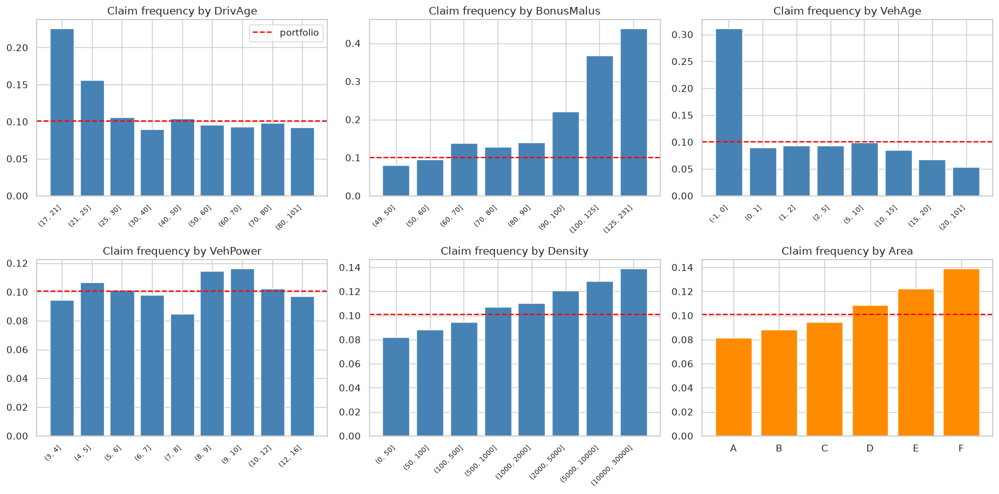
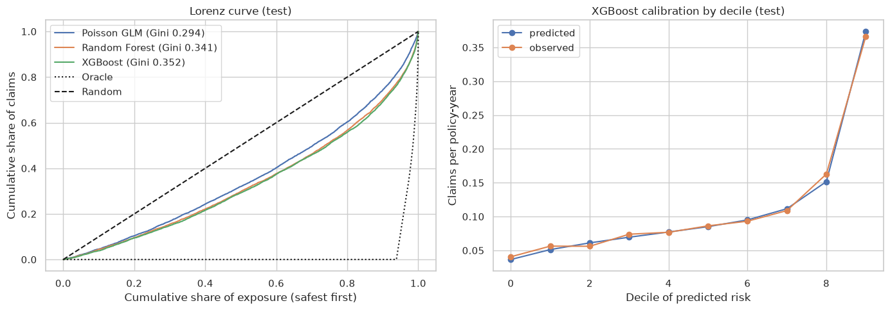
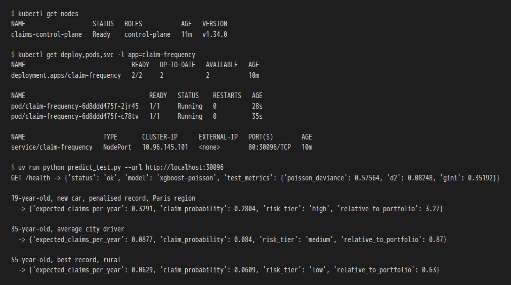
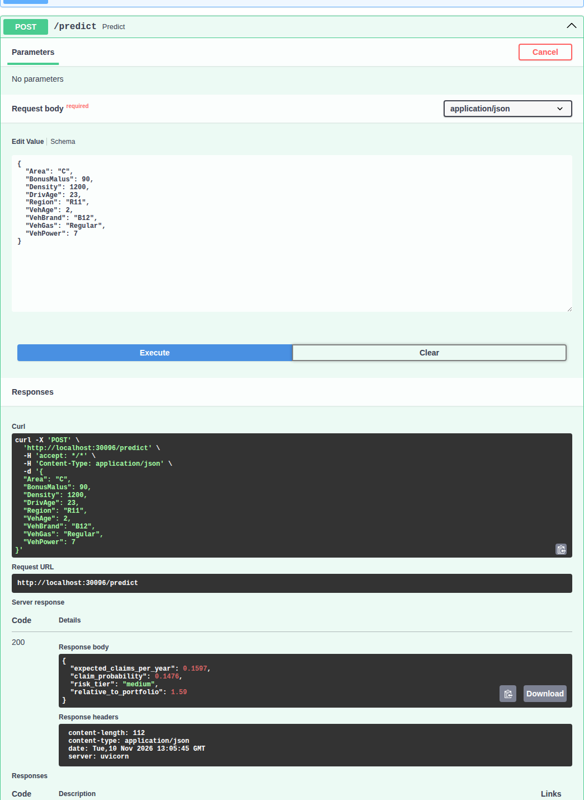

# Car Insurance Claim Frequency

Predicts **how many claims a car insurance policy will file per year** from the driver and vehicle
profile, and serves the model as a web API (FastAPI, Docker, Kubernetes).

Midterm project for [ML Zoomcamp 2026](https://github.com/DataTalksClub/machine-learning-zoomcamp).

| | |
|---|---|
| **Data** | freMTPL2freq: 678,013 French motor insurance policies (public, OpenML id 41214) |
| **Task** | Regression of a count: claims per policy-year, Poisson loss, exposure as weight |
| **Models compared** | Poisson GLM (linear), Random Forest, XGBoost, each tuned |
| **Final model** | XGBoost (`count:poisson`), test Gini **0.352**, deviance explained **8.2%** |
| **Service** | `POST /predict` returns expected claims per year, probability of a claim and a risk tier |
| **Deployment** | Docker image (842 MB) + local Kubernetes cluster (kind), tested with screenshots |

## Contents

1. [Rubric map](#rubric-map)
2. [Problem description](#problem-description)
3. [Dataset](#dataset)
4. [EDA highlights](#eda-highlights)
5. [Models and results](#models-and-results)
6. [How to run](#how-to-run)
7. [Using the API](#using-the-api)
8. [Docker](#docker)
9. [Kubernetes deployment (kind)](#kubernetes-deployment-kind)
10. [Tests](#tests)
11. [Project structure](#project-structure)

## Rubric map

Where each evaluation criterion is covered, to make peer review easier:

| Criterion | Where |
|---|---|
| Problem description | [Problem description](#problem-description) below |
| EDA | `notebook.ipynb` sections 1-4: ranges, missing values, outliers and caps, target (claims, exposure, frequency), frequency by every feature, correlations, univariate feature importance (deviance explained) and permutation importance |
| Model training | `notebook.ipynb` section 6: Poisson GLM (tuned `alpha`), Random Forest (tuned `max_depth`, `min_samples_leaf`), XGBoost (tuned `max_depth`, `min_child_weight`, trees by early stopping, `learning_rate`) |
| Exporting notebook to script | `train.py` (training and saving), shared logic in `common.py` |
| Reproducibility | Data committed in `data/` (6.6 MB) + `download_data.py`; `uv.lock` pins every version; notebook runs top to bottom |
| Model deployment | `predict.py` (FastAPI) |
| Dependency and environment management | `pyproject.toml` + `uv.lock` with uv; virtual environment in `.venv` (see [How to run](#how-to-run)) |
| Containerization | `Dockerfile`, [Docker](#docker) section |
| Cloud deployment | Kubernetes with kind: `k8s/` manifests + `k8s/deploy.sh`, test screenshots in [Kubernetes deployment](#kubernetes-deployment-kind) |

## Problem description

Car insurers and brokers have to set a price for each policy **before** they know if the driver will
crash. The price is built from two parts: **how often** the policy will claim (frequency) and **how
much** each claim costs (severity). This project models the first part.

Given the profile of a policy (driver age, bonus-malus record, car age, power, brand, fuel, where the
driver lives), the model predicts the **expected number of claims per year**. That number can be used to:

- **Price the policy**: premium is roughly proportional to expected claims x average claim cost.
  A 19-year-old with a penalised record is predicted at 3.3x the portfolio average, a 55-year-old with
  the best record at 0.6x - the premium should reflect that.
- **Underwriting**: flag high-risk profiles (`risk_tier = "high"`, the top 10% of the portfolio) for a
  manual review or extra conditions before quoting.
- **Portfolio monitoring**: score all policies to see how risky the book is and where it is moving.

The API is meant to be called by a quoting tool: it receives one policy (or a batch) and answers in
milliseconds.

**Why this is not a standard regression:**
- 95% of policies have zero claims; the target is a skewed count -> we use the **Poisson deviance**
  (the standard loss for counts) instead of squared error.
- Policies are observed for different periods (`Exposure`, from a few days to one year). The target is
  `ClaimNb / Exposure` and every policy is **weighted by its exposure**.
- Most claims are random events, so even a good model explains a small share of the deviance (here
  8%). What matters for pricing is **ranking** risk well, measured with the **Gini** index of the
  Lorenz curve (here 0.35).

## Dataset

**freMTPL2freq** - French Motor Third-Party Liability, one year of policies from a French insurer.
Public on OpenML: [dataset 41214](https://www.openml.org/d/41214) (also in the R package `CASdatasets`).

| Column | Meaning |
|---|---|
| `ClaimNb` | Number of claims during the exposure period (target) |
| `Exposure` | Fraction of the year the policy was active |
| `Area` | Density class of the city, A (rural) to F (urban centre) |
| `VehPower` | Vehicle power class |
| `VehAge` | Vehicle age (years) |
| `DrivAge` | Driver age (years) |
| `BonusMalus` | Bonus-malus level: 50 = best record, above 100 = penalised for past claims |
| `VehBrand` | Anonymised car brand (B1-B14) |
| `VehGas` | Regular or Diesel |
| `Density` | Inhabitants per km2 where the driver lives |
| `Region` | French region code |

The data is committed as `data/freMTPL2freq.csv.gz`. To download it again from OpenML (no account
needed): `uv run python download_data.py`.

Cleaning (decided in the EDA, applied in `common.py`): exposure clipped to 1 year, claims capped at 4
(9 policies with 5-16 claims look like errors), long tails capped (`VehAge` 20, `DrivAge` 90,
`BonusMalus` 150, `VehPower` 12) and `log(Density)`. There are no missing values.

## EDA highlights



Portfolio frequency: **0.10 claims per policy-year**.

- **BonusMalus** is the strongest signal: penalised drivers (above 100) claim 3.7-4.4x the average.
- **Young drivers**: 18-21 claim 2.2x the average, 21-25 1.6x; flat from 30 on.
- **Brand-new cars** (age 0) claim 3.1x the average; older cars claim less.
- **Urban areas** claim more: Area F is 1.4x, Area A 0.8x.
- Fuel and power have weak effects.

## Models and results

Split 60% train / 20% validation / 20% test (seed 42). All models use the Poisson loss with exposure weights.

| Model (validation) | Tuned | Best | Poisson deviance | D2 | Gini |
|---|---|---|---|---|---|
| Baseline (portfolio mean) | - | - | 0.6261 | 0.000 | 0.00 |
| Poisson GLM, one-hot + splines | `alpha` | 0.001 | 0.5942 | 0.051 | 0.292 |
| Random Forest (`criterion="poisson"`) | `max_depth`, `min_samples_leaf` | None, 200 | 0.5762 | 0.080 | 0.344 |
| **XGBoost** (`count:poisson`) | `max_depth`, `min_child_weight`, trees (early stopping), `learning_rate` | 8, 10, 430, 0.05 | **0.5713** | **0.088** | **0.357** |

Final evaluation on the untouched **test set** (models refit on train + validation):

| Model (test) | Poisson deviance | D2 | Gini |
|---|---|---|---|
| Poisson GLM | 0.5971 | 0.048 | 0.294 |
| Random Forest | 0.5795 | 0.076 | 0.341 |
| **XGBoost** | **0.5756** | **0.082** | **0.352** |



**XGBoost was selected**: best on every metric. It is well calibrated (predicted and observed frequency
match across deciles) and separates risk clearly: the riskiest 10% of policies claim about 9x more than
the safest 10% (0.37 vs 0.04 claims per year).

Metrics:
- **Poisson deviance** (lower is better): main tuning metric.
- **D2**: share of the deviance explained vs. predicting the average for everyone.
- **Gini**: how well the model ranks policies from safest to riskiest (0 = random, 1 = perfect).

## How to run

Requirements: [uv](https://docs.astral.sh/uv/getting-started/installation/) (it installs Python 3.11
itself). Docker and kind only for the deployment parts.

```bash
git clone https://github.com/AlfredoSaira/car-insurance-claims.git
cd car-insurance-claims

# Create the virtual environment (.venv) and install the exact locked versions
uv sync

# Optional: activate the environment (otherwise prefix commands with `uv run`)
source .venv/bin/activate        # Windows: .venv\Scripts\activate

# Train the final model -> models/model.bin (about 20 s)
uv run python train.py

# Start the web service on http://localhost:9696
uv run uvicorn predict:app --host 0.0.0.0 --port 9696
```

To re-run the notebook: `uv run jupyter notebook notebook.ipynb` (the full run with all tuning takes
about 10 minutes on 16 cores). It writes `models/best_params.json`, which `train.py` reads.

A trained `models/model.bin` is committed, so you can start the service or build the Docker image
without training.

## Using the API

Interactive docs: http://localhost:9696/docs

```bash
curl -X POST http://localhost:9696/predict \
  -H "Content-Type: application/json" \
  -d '{"Area": "E", "VehPower": 7, "VehAge": 0, "DrivAge": 19, "BonusMalus": 120,
       "VehBrand": "B1", "VehGas": "Regular", "Density": 4000, "Region": "R11"}'
```

```json
{"expected_claims_per_year": 0.3291, "claim_probability": 0.2804,
 "risk_tier": "high", "relative_to_portfolio": 3.27}
```

- `expected_claims_per_year`: predicted claim frequency.
- `claim_probability`: probability of at least one claim in a year, `1 - exp(-frequency)`.
- `risk_tier`: `low` (bottom 50% of the portfolio), `medium`, `high` (top 10%).
- `relative_to_portfolio`: prediction divided by the portfolio average (1.0 = average driver).

Other endpoints: `GET /health`, `POST /predict_batch` (list of policies). Invalid input (e.g. age 12,
unknown fuel) is rejected with HTTP 422 and a message.

Example client with three profiles: `uv run python predict_test.py` (add `--url` for another host).

## Docker

```bash
# Build the image (installs only runtime dependencies from uv.lock)
docker build -t claim-frequency:v1 .

# Run it: maps port 9696 of the container to localhost:9696
docker run -it --rm -p 9696:9696 claim-frequency:v1

# In another terminal
uv run python predict_test.py
```

## Kubernetes deployment (kind)

The service runs on a local Kubernetes cluster created with [kind](https://kind.sigs.k8s.io/)
(2 replicas, readiness/liveness probes on `/health`, NodePort service on port 30096).

Requirements: Docker, [kind](https://kind.sigs.k8s.io/docs/user/quick-start/#installation) and
[kubectl](https://kubernetes.io/docs/tasks/tools/).

```bash
bash k8s/deploy.sh
```

The script builds the image, creates the cluster (`k8s/kind-config.yaml`), loads the image, applies
`k8s/deployment.yaml`, waits for the rollout and calls the API at http://localhost:30096.

Step by step, the same thing:

```bash
docker build -t claim-frequency:v1 .
kind create cluster --config k8s/kind-config.yaml
kind load docker-image claim-frequency:v1 --name claims
kubectl apply -f k8s/deployment.yaml
kubectl rollout status deployment/claim-frequency
kubectl get pods,svc
uv run python predict_test.py --url http://localhost:30096
```

Clean up: `kind delete cluster --name claims`.

**Proof of the deployment** (pods running and the API answering from the cluster):





Full output: [docs/k8s-deploy.log](docs/k8s-deploy.log).

## Tests

```bash
uv run pytest
```

8 tests: feature preparation, metrics, data split, and the API (health, valid prediction, a risky
profile scores higher than a safe one, invalid input rejected).

## Project structure

```
├── README.md
├── notebook.ipynb          # EDA, feature importance, model selection and tuning
├── common.py               # data cleaning, features, model builders, metrics (shared)
├── train.py                # trains the final model -> models/model.bin
├── predict.py              # FastAPI web service
├── predict_test.py         # example client
├── download_data.py        # downloads the dataset from OpenML
├── data/freMTPL2freq.csv.gz
├── models/
│   ├── model.bin           # trained pipeline + risk-tier cut-offs
│   ├── best_params.json    # hyper-parameters chosen in the notebook
│   └── test_metrics.csv
├── Dockerfile
├── k8s/                    # kind config, Deployment + Service, deploy script
├── tests/
├── scripts/build_notebook.py  # source of notebook.ipynb (keeps it diff-friendly)
├── docs/                   # images and deployment log
├── pyproject.toml
└── uv.lock
```

## Limitations

- Only claim **frequency** is modelled; a full price also needs claim **severity** (the companion
  dataset freMTPL2sev).
- French data from one insurer: the brand and region codes are anonymised and the model is not meant
  to be applied directly to another market.
- About 92% of the deviance is unexplained: individual claims are largely random. The model is useful
  for ranking and pricing groups of policies, not for predicting whether one specific driver will crash.
